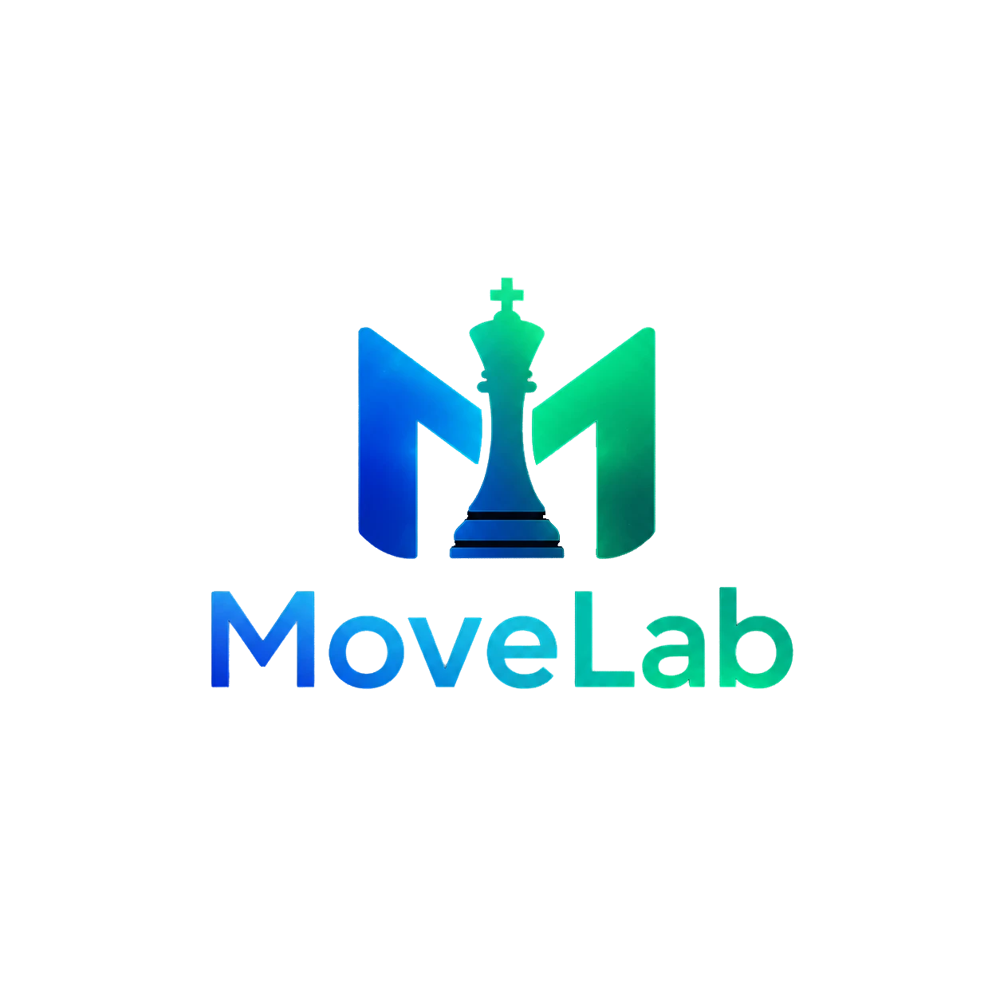
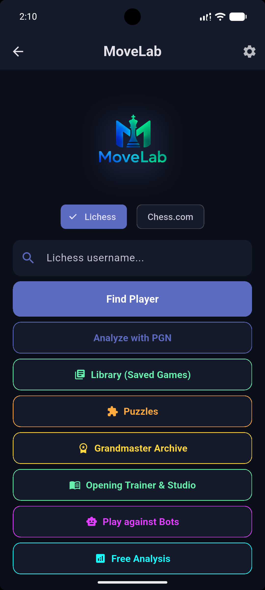
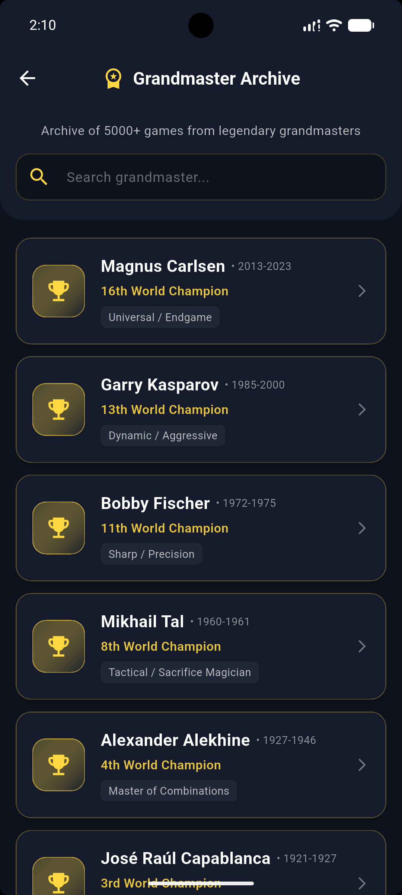
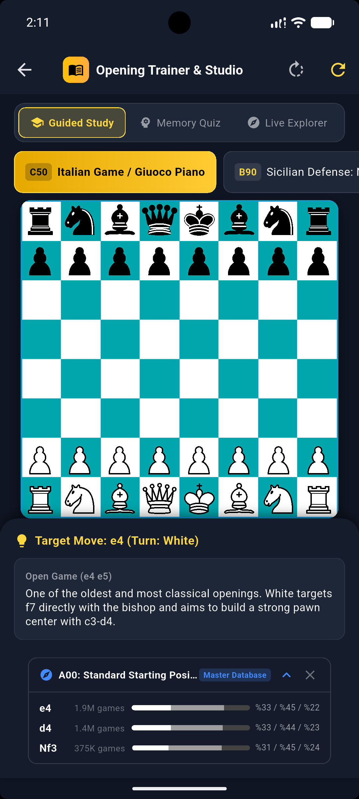
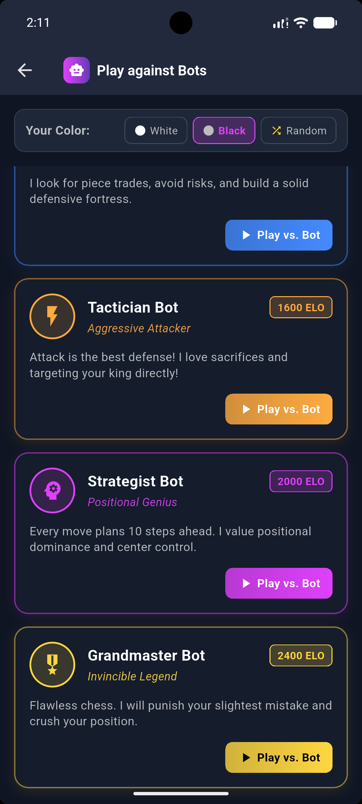
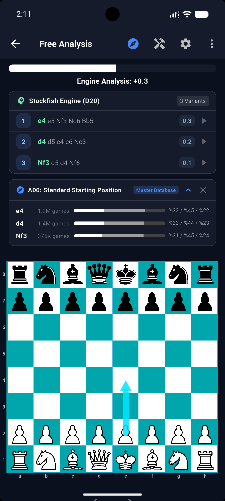
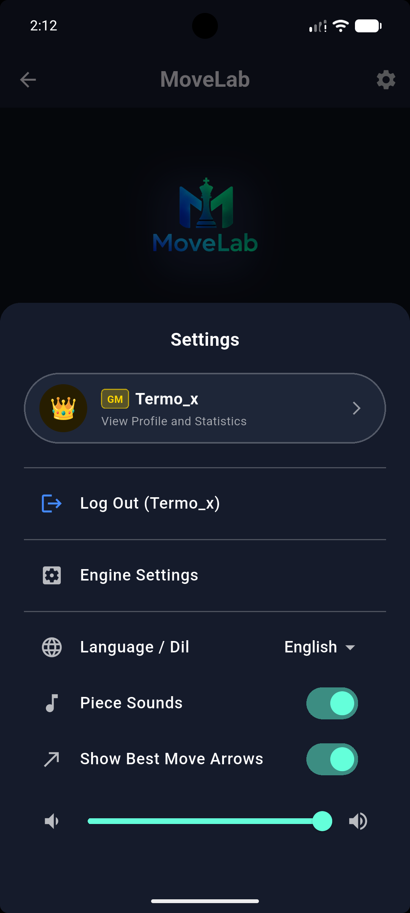

<h1 align="center"> <br>  <br> MoveLab <br> </h1> <h4 align="center">
A comprehensive and professional chess analysis application developed with Flutter.</h4>

# MoveLab Mobile App ♟️

[](https://play.google.com/store/apps/details?id=com.movelab.app&hl=tr)
[](https://flutter.dev/)
[](https://dart.dev/)
[](https://opensource.org/licenses/Apache)
[]()
[]()

Modern, fast and professional chess analysis application powered by **Stockfish**, built entirely with **Flutter**.

</div>

---

# 📖 Overview

MoveLab is a next-generation chess analysis application designed for players who want to deeply analyze their games, understand their playstyle, and improve through advanced engine insights.

The application integrates online chess platforms such as **Lichess** and **Chess.com**, while also providing powerful offline analysis capabilities using the **Stockfish** chess engine.

---

## 🚀 Features

* **Platform Integration:** Seamlessly fetch recent matches and player stats from both **Lichess** and **Chess.com** using their official APIs.
* **Local Engine Analysis:** Powered by a built-in **Stockfish** engine for real-time, deep move analysis (MultiPV support) directly on your device without needing an internet connection.
* **Free Analysis Board:** Set up and explore any position freely with interactive board controls and immediate engine feedback.
* **Interactive Puzzles:** Train your tactical vision and improve your game with built-in chess puzzles.
* **Advanced Move Classification:** Categorizes moves (Brilliant, Great, Best, Excellent, Good, Inaccuracy, Mistake, Blunder) using a custom accuracy algorithm and tactical detectors.
* **Player Style Profiling:** Analyzes recent games to generate a unique "Player Style Profile" (e.g., Aggressive, Positional, Tactical) based on opening choices, game length, and tactical frequency.
* **PGN Analyzer & Custom Library:** Paste custom PGNs for analysis or save your favorite matches directly to the local device storage for future review.
* **Shareable Insights:** Generate and share high-quality visual analysis cards of your gameplay style.

## ♟️ Chess Platform Integration

* Fetch player profiles directly from **Lichess** and **Chess.com**
* Display player ratings:

  * Rapid
  * Blitz
  * Bullet
* Load and analyze recent matches instantly

---

## 🧠 AI-Based Playstyle Analysis

MoveLab automatically categorizes player styles using game statistics and move characteristics.

Supported profiles include:

* Aggressive Player
* Tactical Master
* Positional Player
* Defensive Player
* Endgame Specialist
* Risk Taker
* Universal Player

The application also displays percentage-based playstyle distribution.

---

## ⚙️ Advanced Engine Analysis

Powered by the embedded **Stockfish** engine:

* Real-time move evaluation
* Evaluation bar
* Top 3 engine suggestions
* Best move detection
* Accuracy estimation
* Blunder detection

---

## 🔥 Move Classification System

Every move is automatically categorized:

| Classification | Symbol |
| -------------- | ------ |
| Brilliant      | !!     |
| Great Move     | !      |
| Best Move      |        |
| Excellent      |        |
| Good           |        |
| Inaccuracy     | ?!     |
| Mistake        | ?      |
| Blunder        | ??     |

---

## 📄 PGN Support

* Import PGN games instantly
* Analyze any custom chess game
* Replay and inspect moves interactively

---

## 💾 Offline Match Library

* Save favorite games locally
* Access analysis without internet connection
* Persistent storage using SharedPreferences

---

## 📤 Sharing System

Share:

* Analysis screenshots
* Player profiles
* Player style cards
* PGN exports
* Game summaries

through social media and messaging platforms.

---

## 🎨 Modern UI/UX

* Dark mode focused design
* Smooth animations
* Responsive layouts
* Modern chess-inspired interface
* Customizable move sounds

---

# 🛠️ Tech Stack

MoveLab is built using modern cross-platform technologies.

| Technology          | Purpose                     |
| ------------------- | --------------------------- |
| Flutter             | Cross-platform UI framework |
| Dart                | Programming language        |
| Stockfish           | Chess engine                |
| flutter_chess_board | Interactive chessboard      |
| http                | API communication           |
| shared_preferences  | Local storage               |
| share_plus          | Sharing functionality       |
| audioplayers        | Sound system                |
| path_provider       | File management             |

---


## 🏗️ Architecture

MoveLab is built with a focus on performance and seamless user experience. 

* **Framework:** Flutter (Dart)
* **State Management:** Ephemeral state management via `StatefulWidget` for localized UI updates.
* **Chess Logic & Board:**
  * `flutter_chess_board`: Renders the interactive UI chess board with custom arrow painters.
  * `chess`: Handles FEN/PGN parsing, legal move generation, and game state validation.
* **Engine:** `stockfish` plugin running as a background isolate, communicating via standard UCI protocols.
* **Local Storage:** `shared_preferences` for saving user settings (sound, arrows) and storing the custom match library.
* **Audio:** `audioplayers` for synchronized, authentic chess piece movement and capture sound effects.

## 🛠️ Installation

Follow these steps to build and run the project locally.

### Prerequisites
* Flutter SDK (latest stable version)
* Android Studio / VS Code
* An Android emulator or a physical device connected via USB/Debugging.

### Setup
1. **Clone the repository:**
   ```bash
   git clone https://github.com/eymencanorman/MoveLab-mobile-app.git
   ```
2. **Navigate to the project directory:**
   ```bash
   cd MoveLab-mobile-app
   ```
3. **Install dependencies:**
   ```bash
   flutter pub get
   ```
4. **Run the app:**
   ```bash
   flutter run
   ```

## 📦 Building for Release (APK)

To generate a lightweight and optimized APK for Android devices, use the `split-per-abi` flag. This will create separate APKs for different device architectures, significantly reducing the file size.

```bash
flutter clean
flutter pub get
flutter build apk --split-per-abi --release
```
*The optimized APK will be located in `build/app/outputs/flutter-apk/app-arm64-v8a-release.apk`.*

---

# 📸 Screenshots

<p align="center">
  
  
  
  
  
  
</p>

---

# 🧪 Future Plans

* Cloud synchronization
* User accounts
* Online multiplayer analysis
* Opening explorer
* Puzzle trainer
* Accuracy graphs
* Game insights AI
* More accurate analysis
* More accurate move categorization
* more accurate and faster analyses
* smaller sized application
* notation corrections

---

## 🤝 Contributing

Contributions, issues, and feature requests are welcome! Feel free to check the [issues page](https://github.com/eymencanorman/MoveLab-mobile-app/issues).

Contributions are welcome.

1. Fork the repository
2. Create your feature branch
3. Commit your changes
4. Push the branch
5. Open a Pull Request

---

## 📄 License

This project is licensed under the Apache License 2.0 - see the [LICENSE](LICENSE) file for details.

Licensed under the Apache License, Version 2.0.
You may not use this project except in compliance with the License.

You are free to:

* Use
* Modify
* Distribute
* Commercialize

this software under the terms of the Apache 2.0 license.

---

# ❤️ Acknowledgements

* Flutter Team
* Stockfish Developers
* Lichess API
* Chess.com Public API
* Open-source Flutter community

---

# 👨‍💻 Developer

Developed by **Eymen Can Orman**

[GitHub: @eymencanorman](https://github.com/eymencanorman)
